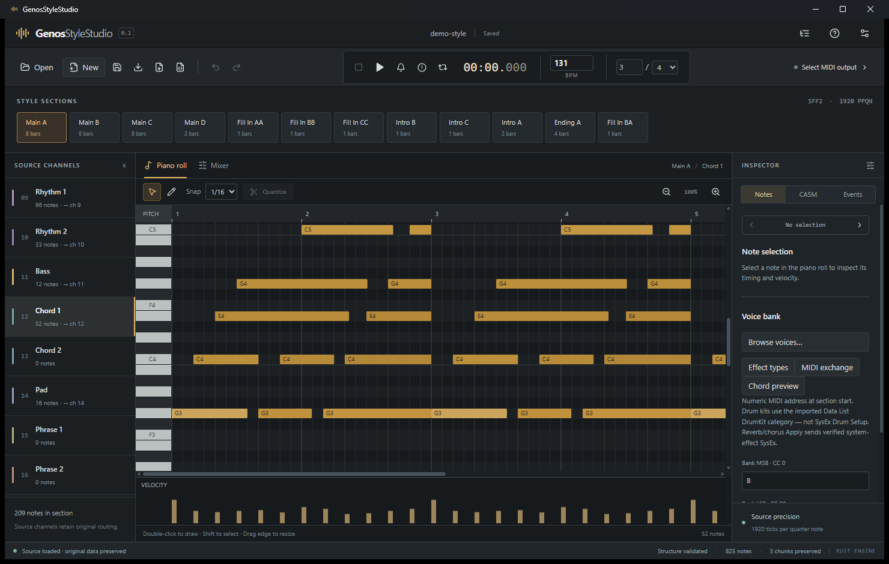
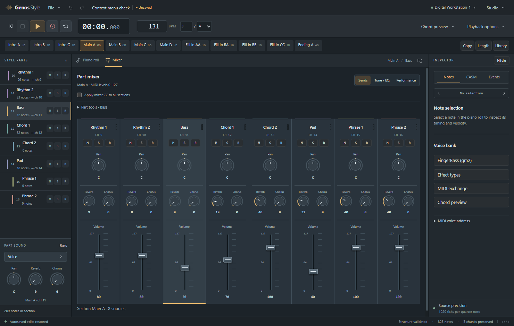
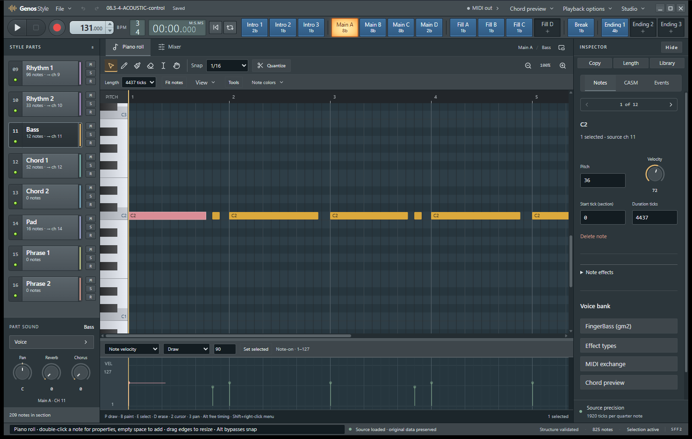
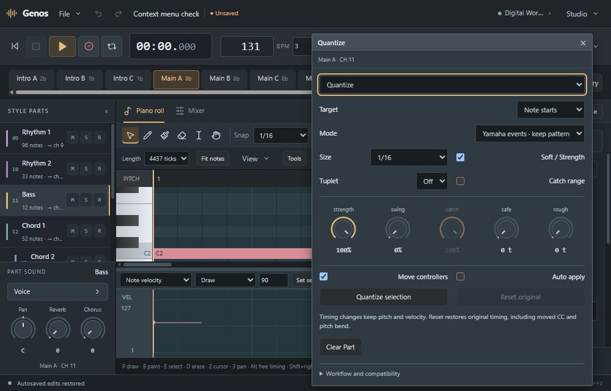
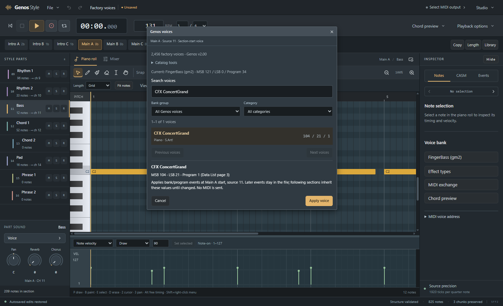

# Genos Style Studio

A Windows desktop editor for Yamaha Genos Style files, built with Tauri 2, React and a Rust MIDI/CASM engine.

Edit source notes, shape controller data, assign voices and inspect routing while preserving the Style's timing and vendor chunks.



## Editing workspace

- **Transport and section bar:** play, stop and record with a tempo field, a compact time-signature control and a time readout, beside the fixed Genos section layout (Intro 1-3, Main A-D, Fill A-D, Break, Ending 1-3). Sections the loaded Style has are lit blue; missing ones stay clickable and open **Add section**.
- **Style parts:** the eight fixed parts as roomy cards with a channel number, an audible LED, a note-density strip and colour-coded Mute, Solo and Record switches.
- **Piano roll:** draw, move, resize, erase, select and copy notes, with snap, zoom and velocity editing.
- **Musical note properties:** a movable utility for pitch, start, length and velocity.
- **Quantize and note tools:** a grid preview that shows what the current size, swing, strength and catch range do, plus timing variation and controller movement, with Undo/Redo.
- **Part mixer:** volume faders, pan and send knobs, tone/EQ controls, mute, solo and record arm. Touching a strip selects that part.
- **Genos voice browser:** 2,456 built-in compatible addresses, including 58 kits; bank/category filters and complete paging. No PDF import is required for stock voices.
- **Style authoring:** section/source navigation, CASM inspection, controller/event editing, project recovery, `.GSS` projects and Style export.
- **Desktop MIDI:** device selection, playback, input monitoring, capture and MIDI exchange.
- **Desktop shell:** a frameless window with its own minimise, maximise and close buttons, in-app confirmation dialogs, a hint bar that names the control under the pointer and shows errors in place.

Compatibility work targets Genos/SFF2. Full arranger/CASM playback equivalence and broader hardware qualification remain in development.

Release qualification remains incomplete as of October 20, 2026. Sections added to a Style from the section bar have not been checked on hardware. The local workspace passes 316 Rust tests and 253 of 254 frontend tests (one App test, the initial-effects opt-in check, currently fails and is under investigation), but the source-only Rust regression suite still requires the ignored research fixtures. Expansion recovery is verified only for the exercised metadata, MIDI setup and existing PPF resource extraction paths; complete encrypted installation-to-editable-PPF reconstruction and Yamaha Expansion Manager/Genos acceptance remain unverified. This build is not approved as a stable release.

## Mixer controls



## Note properties and Quantize

Selected notes show their properties in the inspector, and the editor tools stay in movable desktop windows. Click either screenshot to inspect it at full size.

<table>
  <tr>
    <td width="50%"><a href="assets/note-properties.png"></a></td>
    <td width="50%"><a href="assets/quantize-controls.png"></a></td>
  </tr>
</table>

## Built-in Genos voices

The catalog includes 1,711 panel entries, 480 XG/GM entries and 265 GM2 entries. Voice assignment writes the selected MIDI bank/program address as one undoable edit. Recovered expansion addresses use their own selection path.



Screenshots were captured from the Windows desktop application on October 20, 2026.

## Build and run

Requirements:

- Windows 10/11, x64.
- Node.js 22.12 or newer and npm.
- Stable Rust with the MSVC toolchain.
- Visual Studio C++ Build Tools and a Windows SDK.
- Microsoft Edge WebView2 Runtime.

From the repository root:

```powershell
cd src
npm ci
npm run desktop
```

Create a Windows release and installer locally:

```powershell
cd src
npm run package
```

The executable is written to `src/target/release/`; the NSIS installer (current-user, Start Menu folder **Genos Style Studio**) is written under `src/target/release/bundle/nsis/`. Dependency notices are generated during the build.

### Genos firmware tables for live preview

For pitched and Guitar Ctb2 preview using Genos 2.13 build 52 tables, set
`GENOS_NTT_PRG` to the local `GENOSSETUP.PRG` before starting the app.
Alternatively, set `GENOS_NTT_ELF` to the extracted `17wsh.elf`.
The update image takes precedence if both variables are set. The app verifies
the SHA-256 and loads the tables on first use. If neither variable is set,
the app uses its built-in preview rules. Supply the firmware file locally.
With firmware configured, the Source Tracks dialog also offers **Use Genos
part defaults** to draft a CASM reset for destination parts 9–16.

### GitHub alpha releases

The app is currently versioned as `0.1.0-alpha.1`. For the next alpha, run `npm run bump -- 0.1.0-alpha.2` from `src` and commit the manifests and lockfiles it updates.

Tag the commit you want to release with the matching version and push the tag. For the first alpha, use the following commands.

```powershell
git tag -a v0.1.0-alpha.1 -m "Genos Style Studio 0.1.0-alpha.1"
git push origin v0.1.0-alpha.1
```

The [Release workflow](.github/workflows/release.yml) builds the Windows x64 NSIS installer, generates GitHub release notes, and attaches the installer to a draft. Alpha tags are marked as **prereleases**. Review the draft and its installer before publishing it from GitHub Releases.

To test packaging from a branch, use **Actions → Release → Run workflow** and download the installer from the run's artifacts. Running it on a tag can also finish an existing draft if an earlier run was interrupted.

Windows code signing is not configured yet; SmartScreen may warn on first run until a signing certificate is added.

## Checks

```powershell
cd src
npm run verify
cargo test --workspace --all-targets
```

Corpus tests and native verification scripts also use local reference fixtures under `docs/`. Those research files and device-specific reports are excluded from this repository; the full corpus suite requires that local test data.

## Source layout

```text
assets/                  README screenshots
src/frontend/            React desktop interface and editor controls
src/crates/genos-core/   Style, MIDI, CASM and catalog processing
src/src-tauri/           Desktop shell, native MIDI and IPC
src/scripts/             Build helpers and desktop verification
```
