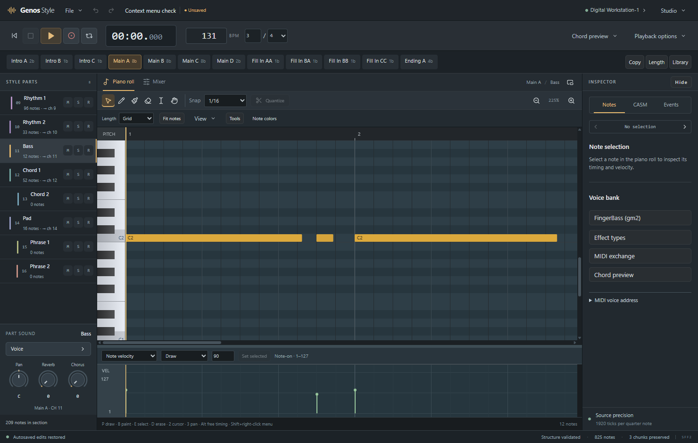
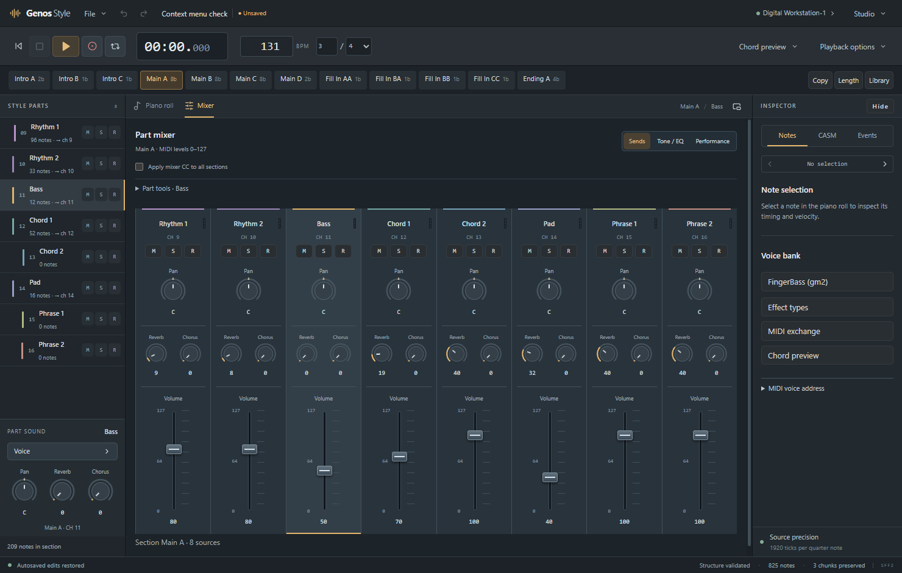
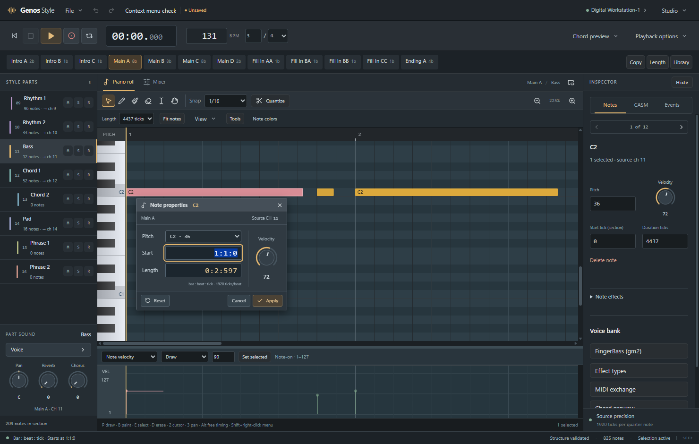
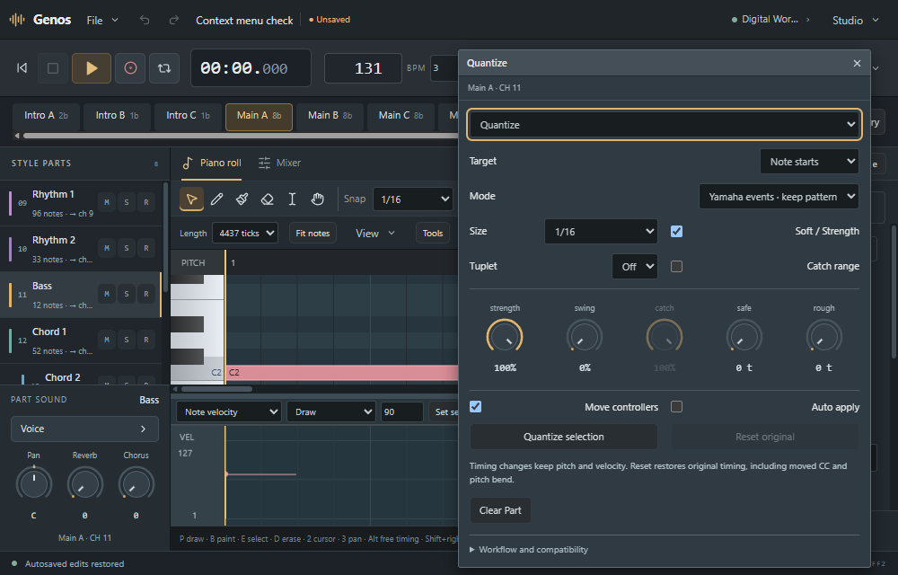
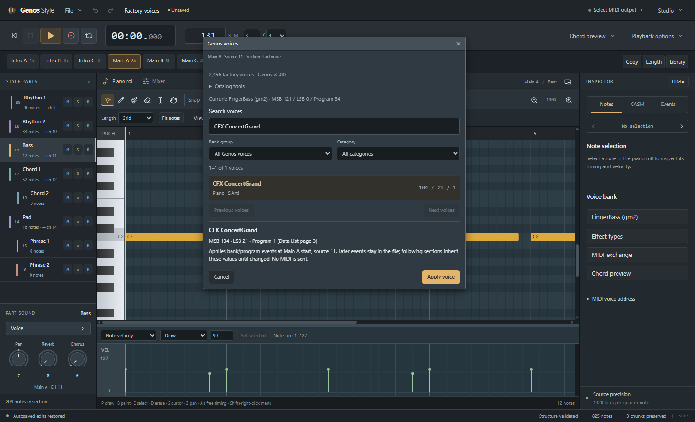

# Genos Style Studio

A Windows desktop editor for Yamaha Genos Style files, built with Tauri 2, React and a Rust MIDI/CASM engine.

Edit source notes, shape controller data, assign voices and inspect routing while preserving the Style's timing and vendor chunks.



## Editing workspace

- **Piano roll:** draw, move, resize, erase, select and copy notes, with snap, zoom and velocity editing.
- **Musical note properties:** a movable utility for pitch, start, length and velocity.
- **Quantize and note tools:** strength, swing, catch range, timing variation and controller movement, with Undo/Redo.
- **Part mixer:** volume faders, pan and send knobs, tone/EQ controls, mute, solo and record arm.
- **Genos voice browser:** 2,456 built-in compatible addresses, including 58 kits; bank/category filters and complete paging. No PDF import is required for stock voices.
- **Style authoring:** section/source navigation, CASM inspection, controller/event editing, project recovery, `.GSS` projects and Style export.
- **Desktop MIDI:** device selection, playback, input monitoring, capture and MIDI exchange.

Compatibility work targets Genos/SFF2. Full arranger/CASM playback equivalence and broader hardware qualification remain in development.

## Mixer controls



## Note properties and Quantize

The editor tools stay in movable desktop windows. Click either screenshot to inspect it at full size.

<table>
  <tr>
    <td width="50%"><a href="assets/note-properties.png"></a></td>
    <td width="50%"><a href="assets/quantize-controls.png"></a></td>
  </tr>
</table>

## Built-in Genos voices

The catalog includes 1,711 panel entries, 480 XG/GM entries and 265 GM2 entries. Voice assignment writes the selected MIDI bank/program address as one undoable edit. Recovered expansion addresses use their own selection path.



Screenshots were captured from the Windows desktop application on October 19, 2026.

## Build and run

Requirements:

- Windows 10/11, x64.
- Node.js 22.12 or newer and npm.
- Stable Rust with the MSVC toolchain.
- Visual Studio C++ Build Tools and a Windows SDK.
- Microsoft Edge WebView2 Runtime.

From the repository root:

```powershell
cd src
npm ci
npm run desktop
```

Create a Windows release and installer:

```powershell
cd src
npm run package
```

The executable is written to `src/target/release/`; the NSIS installer is written under `src/target/release/bundle/nsis/`. Dependency notices are generated during the build.

## Checks

```powershell
cd src
npm run verify
cargo test --workspace --all-targets
```

Corpus tests and native verification scripts also use local reference fixtures under `docs/`. Those research files and device-specific reports are excluded from this repository; the full corpus suite requires that local test data.

## Source layout

```text
assets/                  README screenshots
src/frontend/            React desktop interface and editor controls
src/crates/genos-core/   Style, MIDI, CASM and catalog processing
src/src-tauri/           Desktop shell, native MIDI and IPC
src/scripts/             Build helpers and desktop verification
```
